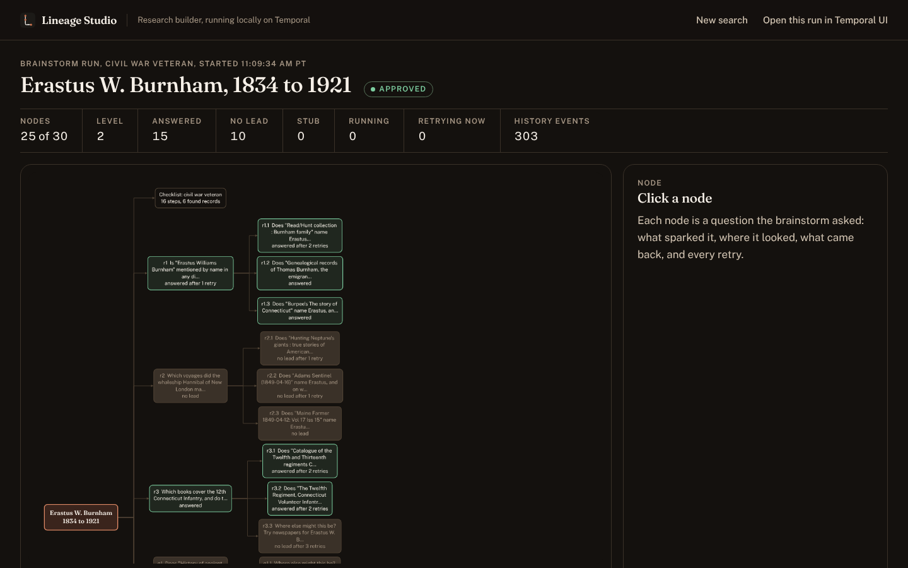
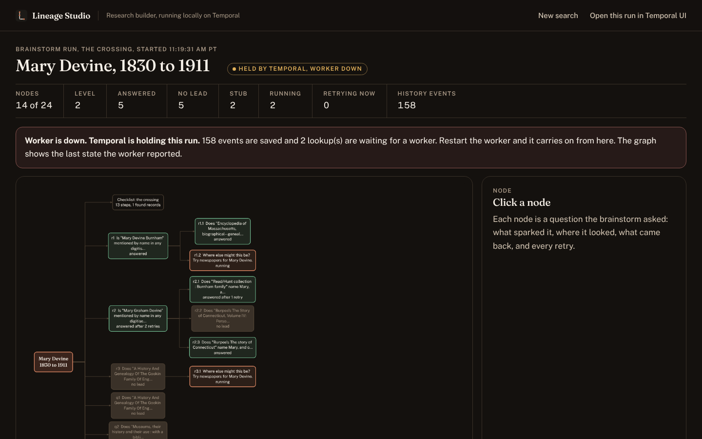
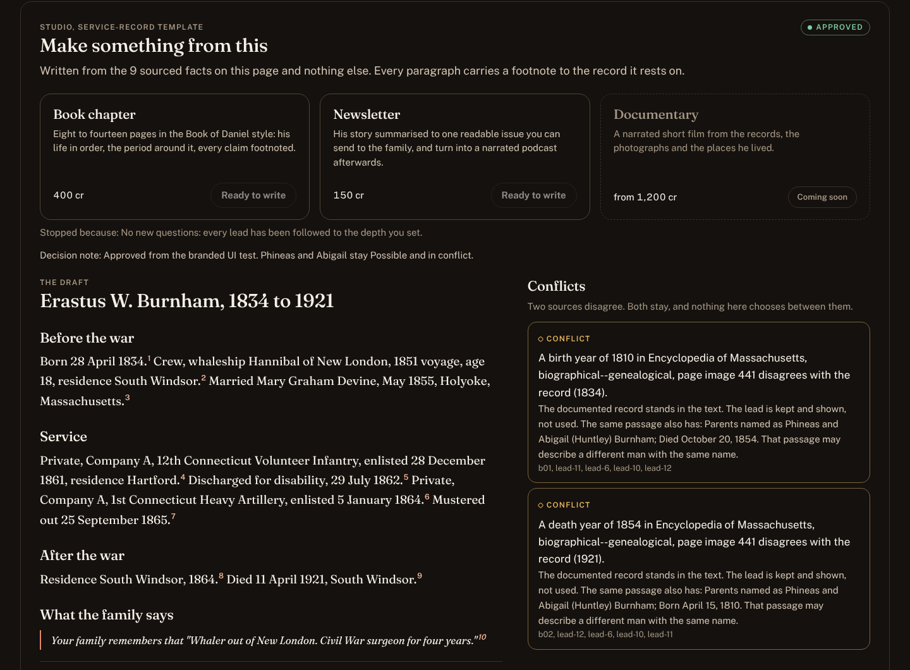
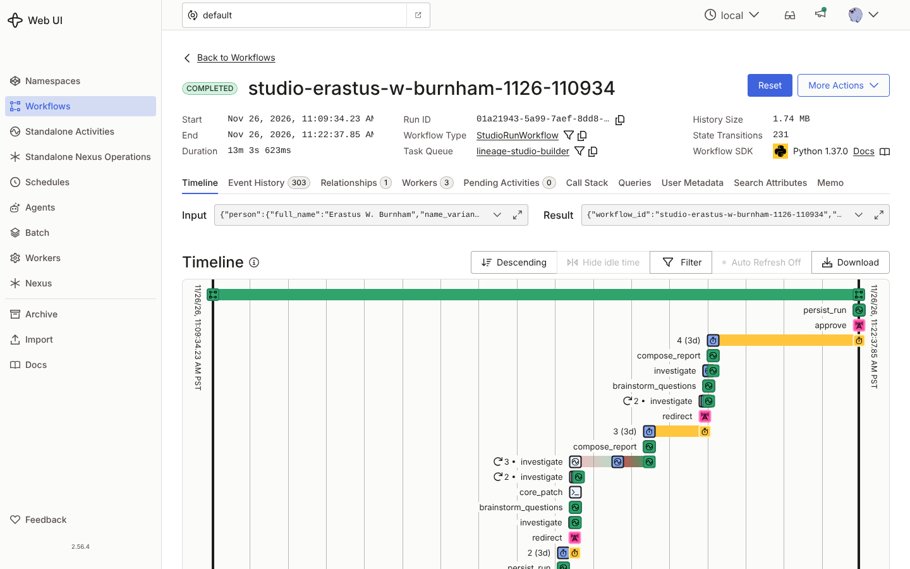

<p align="center">
  
</p>

<p align="center">
  <a href="https://github.com/Verafyai/curiosity-recursion/releases/tag/v0.1.0"></a>
  <a href="https://github.com/temporalio/sdk-python"></a>
  <a href="paper/main.pdf"></a>
  <a href="LICENSE"></a>
  
  
</p>

<h3 align="center">
  <a href="https://verafyai.github.io/curiosity-recursion/paper/main.pdf">📄 Click to read the research paper</a>
  &nbsp;·&nbsp;
  <a href="https://verafyai.github.io/curiosity-recursion/benchmark/">Benchmark web page</a>
  &nbsp;·&nbsp;
  <a href="https://github.com/Verafyai/curiosity-recursion">Code on GitHub</a>
</h3>

**Curiosity Recursion** turns every research finding into new, evidence-quoting questions and runs that loop durably on Temporal, so a long genealogy search never asks the same thing twice and never loses its place.

## Benchmark

<p align="center">
  <a href="https://verafyai.github.io/curiosity-recursion/benchmark/"></a>
  <br><sub>Generated by <code>scripts/make_snapshot.py</code> from the latest result set every time the benchmark runs.</sub>
</p>

**What the benchmark measures, in plain English.** We took six people from one family, all deceased, from a Civil War soldier born in 1834 to a man born in 1967, whose lives were already researched by hand into full dossiers (records, newspaper items, books, letters). Each research strategy gets only the person's **name and birth year** and 100 lookups in free public sources (Internet Archive, Chronicling America, Wikidata). We split each dossier into single facts and froze them as a versioned answer key (`eval/answer_keys/v1`). A fact scores 1 point when an item the strategy returned states it about the right person (name, year and content words together), half a point when the strategy at least reached one of the fact's own sources, and 0 otherwise. Each strategy runs three times per person.

Two safeguards keep the score honest:

- **Exclusion filter.** The author's own websites, repositories, deployments, accounts and their archive snapshots are blocked at the tool layer, and any page that copies eight or more words in a row from a dossier is dropped and logged. A strategy cannot "find" a fact by reading the answer.
- **Reachability ceiling.** Most dossier facts come from paywalled newspapers, military files, books and family interviews that no free tool can reach. We mark a fact *reachable* when one of its sources is on archive.org, loc.gov or wikidata.org, and report every score twice: as a share of the full dossier and as a share of the reachable facts.

Strategies: **B0** single-pass search, **B1** a ReAct agent, **B3** a fixed checklist, **B5** Curiosity Recursion as preregistered, and the post hoc variants **B5-max** (wider, deeper), **B5-fix** (repaired question rules) and **B5-llm** (a model writes the questions). Each has a folder under [`strategies/`](strategies/); copy `strategies/TEMPLATE` to add your own.

```bash
scripts/run-bench.sh                     # one command: run every strategy, score, rebuild the leaderboard and snapshot
scripts/run-bench.sh --conditions B5-fix --runs 3   # one strategy; see the script header for --people, --budget, --jobs
```

<!-- RESULTS:BEGIN -->
### Headline: corpus replication (answer key v1, scorer v1.1)

**Curiosity Recursion (preregistered, B5) recovered 9.8% of six hand-built family dossiers in one pass from a name and birth year, vs 11.6% for a ReAct agent and 6.9% for single-pass search.** CR lost to ReAct (0 people better, 4 worse, exact sign-flip p = 0.125) and beat single pass. A post hoc repair of its question rules (B5-fix) reached 12.4%; CR with a model writing its questions (B5-llm) reached 9.3%. CR was the most precise: 66.9% of the items it cited were about the right person, vs 49.3% for ReAct. With six people no difference is statistically significant.

**The bigger finding is the reachability ceiling.** Most dossier facts come from paywalled newspapers, military records, books and family interviews that the benchmark's free tools cannot reach (reachable facts per person: Erastus Burnham 111, Homer St. John 0, John St. John 2, Kingsley Perry 144, Edgar H. Bristol 61, Alex St. John 89). On reachable facts only, the order is the same: B5 19.4%, B1 22.0%, B0 14.3%, B5-fix 24.4%.

| Rank | Strategy | Erastus Burnham (Civil War) | Homer St. John (WWI) | John St. John (WWII) | Kingsley Perry (civilian) | Edgar H. Bristol (civilian) | Alex St. John (civilian) | Overall | Reachable only | Precision | Penalised | Spend |
|---|---|---|---|---|---|---|---|---|---|---|---|---|
| 1 | B5-fix: CR rules2 (post hoc fix) | 22.6 ± 0.0 | 0.0 ± 0.0 | 0.0 ± 0.0 | 11.4 ± 0.0 | 36.2 ± 0.0 | 3.9 ± 0.9 | 12.4% | 24.4% | 67.2% | 11.6% | $0.00 |
| 2 | B1: ReAct LLM agent | 18.6 ± 1.0 | 0.0 ± 0.0 | 0.0 ± 0.0 | 8.5 ± 1.1 | 35.8 ± 0.7 | 6.4 ± 2.0 | 11.6% | 22.0% | 49.3% | 11.3% | $0.35 |
| 3 | B5-max: CR wider (post hoc) | 18.1 ± 0.0 | 0.0 ± 0.0 | 0.0 ± 0.0 | 1.9 ± 0.0 | 36.2 ± 0.0 | 3.9 ± 0.9 | 10.0% | 19.7% | 65.7% | 9.7% | $0.00 |
| 4 | B5: CR (preregistered) | 17.5 ± 0.0 | 0.0 ± 0.0 | 0.0 ± 0.0 | 1.9 ± 0.0 | 35.6 ± 0.0 | 3.9 ± 0.9 | 9.8% | 19.4% | 66.9% | 9.5% | $0.00 |
| 5 | B5-llm: CR, model question generator (ablation, post hoc) | 14.1 ± 1.0 | 0.0 ± 0.0 | 0.0 ± 0.0 | 5.2 ± 4.2 | 31.4 ± 3.8 | 4.9 ± 0.0 | 9.3% | 18.8% | 32.0% | 9.1% | n.m. |
| 6 | B0: single-pass LLM search | 13.7 ± 0.4 | 0.0 ± 0.0 | 0.0 ± 0.0 | 6.5 ± 2.7 | 19.2 ± 15.6 | 2.1 ± 0.0 | 6.9% | 14.3% | 30.5% | 6.9% | $0.01 |
| 7 | B3: checklist only | 0.0 ± 0.0 | 0.0 ± 0.0 | 0.0 ± 0.0 | 0.0 ± 0.0 | 0.0 ± 0.0 | 2.1 ± 0.0 | 0.4% | 1.1% | 57.4% | 0.4% | $0.00 |

Reachable facts only:

| Strategy | Erastus Burnham (111 reachable) | Homer St. John (0 reachable) | John St. John (2 reachable) | Kingsley Perry (144 reachable) | Edgar H. Bristol (61 reachable) | Alex St. John (89 reachable) | Mean (reachable) |
|---|---|---|---|---|---|---|---|
| B5-fix | 41.4 ± 0.0 | n.m. | 0.0 ± 0.0 | 18.4 ± 0.0 | 51.6 ± 0.0 | 10.3 ± 2.3 | 24.4% |
| B1 | 33.9 ± 0.9 | n.m. | 0.0 ± 0.0 | 11.2 ± 0.5 | 51.1 ± 0.9 | 13.7 ± 2.6 | 22.0% |
| B5-max | 33.3 ± 0.0 | n.m. | 0.0 ± 0.0 | 3.1 ± 0.0 | 51.6 ± 0.0 | 10.3 ± 2.3 | 19.7% |
| B5 | 32.9 ± 0.0 | n.m. | 0.0 ± 0.0 | 3.1 ± 0.0 | 50.8 ± 0.0 | 10.3 ± 2.3 | 19.4% |
| B5-llm | 27.8 ± 0.5 | n.m. | 0.0 ± 0.0 | 8.3 ± 6.8 | 44.8 ± 5.5 | 12.9 ± 0.0 | 18.8% |
| B0 | 27.9 ± 0.8 | n.m. | 0.0 ± 0.0 | 10.5 ± 4.4 | 27.3 ± 22.2 | 5.6 ± 0.0 | 14.3% |
| B3 | 0.0 ± 0.0 | n.m. | 0.0 ± 0.0 | 0.0 ± 0.0 | 0.0 ± 0.0 | 5.6 ± 0.0 | 1.1% |

By era:

| Strategy | Civil War | WWI | WWII | civilian |
|---|---|---|---|---|
| B5-fix | 22.6% | 0.0% | 0.0% | 17.2% |
| B1 | 18.6% | 0.0% | 0.0% | 16.9% |
| B5-max | 18.1% | 0.0% | 0.0% | 14.0% |
| B5 | 17.5% | 0.0% | 0.0% | 13.8% |
| B5-llm | 14.1% | 0.0% | 0.0% | 13.8% |
| B0 | 13.7% | 0.0% | 0.0% | 9.3% |
| B3 | 0.0% | 0.0% | 0.0% | 0.7% |

**Leakage audit.** Every strategy ran with the exclusion filter on (the author's own sites, repos, deployments and accounts blocked at the tool layer; pages copying dossier prose dropped). No call reached a blocked host. In this result set every dropped item we read was a page of a primary source that the dossiers quote, not a copy of the dossier.

| Strategy | Runs | Blocked by host rule | Dropped by dossier-overlap guard | Runs without a tool log |
|---|---|---|---|---|
| B5-fix | 18 | 0 | 6 | 0 |
| B1 | 18 | 0 | 8 | 0 |
| B5-max | 18 | 0 | 6 | 0 |
| B5 | 18 | 0 | 0 | 0 |
| B5-llm | 18 | 0 | 2 | 0 |
| B0 | 18 | 0 | 0 | 0 |
| B3 | 18 | 0 | 0 | 0 |

**Scorer audit.** 80 sampled decisions checked by an independent model judge: 85.0% agreement, kappa 0.70. Every disagreement was then read one by one by an AI assistant (not a human rater): 32/40 sampled credited facts are supported by their evidence and 0/40 uncredited facts were missed, so read absolute scores as upper bounds. The scorer was revised once after its first audit (v1.0 to v1.1), for every strategy alike.

### DarkKin-Bench v0 (preregistered, record-level, pilot)

Hidden-record recall on 39 subjects (candidate matching, not adjudicated; runs before the exclusion filter existed, retro audit of every cited item found 0 blocked or copied items).

| Agent | Budget | Subjects | Macro recall [95% CI] | Tool calls / run | USD / run |
|---|---|---|---|---|---|
| B0 | 25 | 39 | 0.137 [0.089, 0.187] | 6.9 | 0.0005 |
| B0 | 50 | 39 | 0.156 [0.107, 0.206] | 6.5 | 0.0005 |
| B0 | 100 | 39 | 0.150 [0.106, 0.194] | 6.1 | 0.0005 |
| B1 | 25 | 38 | 0.227 [0.165, 0.291] | 21.4 | 0.0205 |
| B1 | 50 | 38 | 0.217 [0.155, 0.281] | 21.2 | 0.0211 |
| B1 | 100 | 39 | 0.234 [0.174, 0.296] | 20.8 | 0.0214 |
| B3 | 25 | 39 | 0.051 [0.023, 0.083] | 12.2 | 0.0000 |
| B3 | 100 | 39 | 0.053 [0.023, 0.085] | 12.2 | 0.0000 |
| B5 | 25 | 39 | 0.125 [0.078, 0.174] | 23.9 | 0.0000 |
| B5 | 50 | 39 | 0.118 [0.075, 0.163] | 25.1 | 0.0000 |
| B5 | 100 | 39 | 0.112 [0.069, 0.158] | 25.0 | 0.0000 |
| B5-max | 100 | 39 | 0.140 [0.090, 0.192] | 61.0 | 0.0000 |

Preregistered H1 at B=100 (all 39 subjects): B5 vs B0: mean diff -0.038, Holm p=0.171; B5 vs B1: mean diff -0.123, Holm p=0.000672; B5 vs B3: mean diff +0.059, Holm p=0.033. **CR (B5) loses to ReAct (B1) and does not beat single pass (B0); it beats checklist only (B3).**

H2 (pilot, 4 subjects, p=0.3 with worker kills): both completed 12/12 runs; lost-and-redone lookups per kept lookup 0.00 for B5 (Temporal) vs 6.17 for B4 (plain asyncio).

H3 (memory, 8 subjects, second run): tool calls 24.5 then 25.4, recall unchanged (0.125); no saving measured.

<!-- RESULTS:END -->

Full tables, statistics, the scorer audit and history are on the [benchmark page](https://verafyai.github.io/curiosity-recursion/benchmark/) ([`benchmark/BENCHMARK.md`](benchmark/BENCHMARK.md)). The scoring rules are in [`eval/EVAL-SPEC.md`](eval/EVAL-SPEC.md).

### Privacy

Only people who pass the living-person gate (a death on record, a birth at least 110 years ago, or a documented family attestation) appear in the public answer keys. Living relatives are redacted to `[relative]` and appear publicly only as aggregate counts; the unredacted keys and raw run logs stay in the gitignored `eval/private/`. The keys hold citations, never book text.

## Why this exists

Research agents stop early. Ask one to trace a relative through old records and it returns a tidy, incomplete answer, and you end up typing the same things over and over: *go deeper*, *are you sure that is the same man?*, *did you check the church registers?*, *did that archive ever reply?* The supervising becomes the real work, and none of it is written down. Come back a month later with a new name and there is no way to know whether it will get the same care.

Genealogy makes this worse, because the records are **dark data**. They exist, but the systems that should find them cannot see them: a soldier named on page 14 of a scanned regimental history with no index, a marriage register a town clerk answers by mail in three weeks, a box of letters in a cousin's closet. Finding them takes the right next question, then patience.

Two things changed that make a better answer possible. Language models can now read a finding and propose a specific next question. Durable execution engines like [Temporal](https://temporal.io) can keep a long, flaky, human-in-the-loop process alive for days or weeks without losing its place.

**curiosity-recursion** puts the two together. It writes the supervisor's loop down as code.

## What it does

You put in the name of someone who has died. Then:

1. **A circuit runs first.** A baseline checklist for their heritage group (Civil War veteran, the crossing, vital records). "Did you check the synagogues?" becomes a line item that is checked or not.
2. **Every finding sparks new questions.** *He served in the 12th Connecticut* becomes *which books cover that regiment?*, then *does this book name him, and on which page?*, then *are you sure it is the same Erastus?* This is **Curiosity Recursion**.
3. **Every question must quote its evidence.** A question that cannot name the finding that sparked it is rejected. The graph stays auditable.
4. **Nothing is asked twice.** Every question is stored, so the next run rechecks what earlier runs asked and skips repeats.
5. **It survives anything.** Lookups are retried activities, levels are separated by durable timers, and killing the worker loses nothing.
6. **A person stays in charge.** Letters to archives are drafted and held for approval; nothing is ever sent. The report is written only from documented records, with name matches shown as leads and contradictions named, never resolved.

<p align="center">
  
  <br><sub>A real run: the person on the left, every question it asked to the right, each node labelled with what happened.</sub>
</p>

## How it works


The loop is one Temporal workflow. Workflow code decides; every side effect (a full-text search, a search inside a book, writing to the question store) is an activity that Temporal records, retries and never repeats once it has finished.

| | |
|:--|:--|
|  |  |
| **Every node explains itself:** the question, the finding that sparked it, where it looked, what came back, every retry, and any lead it produced. | **Kill the worker mid-run.** Temporal holds the run; restart the worker and it carries on from the same question. |
|  |  |
| **The report** uses only documented records, footnotes every sentence, and names conflicts. Here it caught that a "parents" line describes a man born in 1810, not this one. | **The event history is the audit trail.** Every question, retry, timer and human decision, replayable. |

## Quickstart

Runs on a laptop. No API key needed.

```bash
temporal server start-dev --ui-port 8233          # Temporal CLI; leave it running
python -m venv .venv && .venv/bin/pip install -r requirements.txt
export CR_CONTACT="you@example.org"               # a contact address for polite HTTP access
.venv/bin/python worker.py &                      # task queue: curiosity-recursion
.venv/bin/uvicorn web.app:app --port 8090 &       # live graph UI
.venv/bin/python start_run.py examples/erastus.json
```

Open **http://localhost:8090** for the live graph and **http://localhost:8233** for the Temporal UI. Then try `kill -9` on the worker and start it again.

```bash
.venv/bin/python -m pytest -q tests               # 35 tests, including replay and no-send
```

## The run request

Every switch is a field of `ResearchRequest`, so every idea in the paper can be turned off and measured:

| Field | What it controls |
|:--|:--|
| `depth`, `breadth`, `max_nodes` | How far down one lead, how many questions per finding, how big the graph gets |
| `max_tool_calls` | The budget *B*: checklist steps plus investigations |
| `max_run_minutes`, `level_pause_seconds` | Wall-clock limit and the durable timer between levels |
| `generator` | `rules` (default, no model), `llm` (grounded, key from env) or `hybrid` |
| `use_memory`, `use_circuits`, `verify_nodes`, `dedupe` | The ablations |
| `use_fixtures` | Demo facts from a curated fixture; always off in the benchmark |
| `llm_token_budget` | A hard stop for the model generator |

## Layout

```
cr/                  the Curiosity Recursion engine (workflow, activities, generators, gate, evidence, sources)
  sources/live.py    public keyless clients, wrapped by the exclusion filter (sources/exclusion.py)
studio/              Lineage Studio: the research builder UI on Temporal
web/                 live graph UI (Cytoscape.js)
bench/               DarkKin-Bench v0: PREREGISTRATION.md, DATASHEET.md, harness, faults, baselines, data/public
eval/                EVAL-SPEC.md, answer_keys/v1 (frozen, versioned), corpus/ (score, report, audit, stats, diagnose),
                     exclusion/, score.py, stats.py, plots.py, fill_v0.py
strategies/          one folder per approach (B0 ... B5-llm) plus TEMPLATE
benchmark/           leaderboard (index.html, BENCHMARK.md), results/<key>/<stamp>/, assets/snapshot.png
paper/               the paper (main.tex, sections/, generated/ tables, figures/, main.pdf) and whitepaper/
decks/               slide decks
results/v0/          DarkKin-Bench v0 measured results (H1 to H3)
scripts/             run-bench.sh, release.sh, build_leaderboard.py, make_snapshot.py, readme_results.py
tests/               gate, grounding and dedupe, evidence, replay, time skipping, no send, scoring
```

## Releases and versions

The code, the paper and the benchmark share one version in [`VERSION`](VERSION) (semver, starting at v0.1.0). `scripts/release.sh patch|minor|major "summary"` bumps it everywhere (VERSION, CITATION.cff, the paper title page, the README badges), adds a CHANGELOG entry, commits and tags. It never pushes. `scripts/run-bench.sh` regenerates the result set, leaderboard, snapshot, README results block, paper tables and PDF. See [`CHANGELOG.md`](CHANGELOG.md).

## DarkKin-Bench

A benchmark of hidden records about deceased people, stratified by how dark each record is:

| Tier | Meaning | Scored as |
|:--|:--|:--|
| **T0** | Online and indexed (a catalogue record, a Wikidata statement) | Found |
| **T1** | Online as OCR text or page images only (scanned books, newspapers) | Found, with the page |
| **T2** | Behind a login, paywall or captcha | The right holding named and a correct request drafted |
| **T3** | Offline only (an archive, a church, a town clerk, a family box) | The right holder, record and identifiers in a drafted request |

Version 0 has 39 subjects and 671 hidden records. The hypotheses, budgets and tests are fixed in [`bench/PREREGISTRATION.md`](bench/PREREGISTRATION.md) before any run; a sealed holdout is scored once, at the end.

```bash
.venv/bin/python bench/convert_kin.py --relatives PATH/relatives.json --heritage PATH/heritage-real.json
.venv/bin/python bench/harness.py --agents B3,B5 --budgets 50,100 --split dev --out results/h1.jsonl
.venv/bin/python bench/faults.py --agent B5 --fault-p 0.3 --kill-every 45 --subjects kinher-jewish-01 --out results/h2.jsonl
.venv/bin/python eval/score.py results/h1.jsonl
```

`scripts/run_all.sh` runs everything in order. Automatic matches are candidates until two raters adjudicate them ([`eval/adjudicate/GUIDE.md`](eval/adjudicate/GUIDE.md)).

## Sources

| Source | Mode | Notes |
|:--|:--|:--|
| Internet Archive: catalogue, full-text, search inside one book | live, keyless | lending books refuse inside-book search (HTTP 403), recorded as "source refused" |
| Chronicling America via loc.gov | live, keyless | about 30 s a query |
| Wikidata | live, keyless | some cloud addresses get HTTP 429 on every call |
| Optional public source catalogue (`CR_CATALOG_URL`) | live, keyless | off by default; read-only |
| Vital records, census before 1950, parents, children, work, passenger lists, naturalisation, state roster | stub | demo mode reads `fixtures/burnham-erastus.json`; benchmark mode reads nothing |
| Find a Grave | stub | links only; terms prohibit automated access |
| Pension index, National Archives catalogue, local archive collections | stub | produce outreach drafts for a person to approve |
| Simulated archives (`cr/sources/mock_archive.py`) | bench only | answer drafts by signal after 3 to 21 simulated days |

## Rules this code keeps

- **Deceased people only.** The gate runs in workflow code before any lookup: a death on record, or a birth at least 110 years ago. Unknown means living.
- **Leads are not facts.** A name in OCR text is a lead, shown with its quote. A surname alone never links two people. Conflicts are named, never resolved.
- **Ask first.** Outreach is drafted and held; approval writes a text file. No code path sends mail ([`tests/test_no_send.py`](tests/test_no_send.py)).
- **Polite access.** No scraping where prohibited, no captcha or paywall bypass, rate limits, a contact address in the user agent.
- **Keys stay in the worker's environment** and are optional.

## Known gaps

- Curiosity Recursion did not beat a ReAct agent on either benchmark. See the paper's diagnosis: repeated searches inside the same book, a question generator that runs out of new questions, and a ceiling set by what free sources hold.
- The corpus benchmark has six people from one family and no holdout yet. With six people no difference is statistically significant.
- The scorer is automatic. An audit of 80 judgments by a model judge, with every disagreement reread by an AI assistant, is reported; no human rater has checked it yet, and absolute scores are upper bounds.
- No continue-as-new yet: a 25-node run reached 303 events and 1.74 MB of history.
- Activities have no heartbeat timeout, so a killed worker's in-flight lookup waits for its 90 s start-to-close timeout before it is retried.
- Wikidata rate limits from shared cloud addresses can fail lookups in some runs; the 429 count is logged per run.

## Citing

See [`CITATION.cff`](CITATION.cff), or use the **Cite this repository** button on GitHub. The paper is *Curiosity Recursion: Durable, Grounded Question Graphs for Genealogical Dark Data*.

## License

Apache-2.0. See [`LICENSE`](LICENSE) and [`NOTICE`](NOTICE).

<p align="center"></p>
