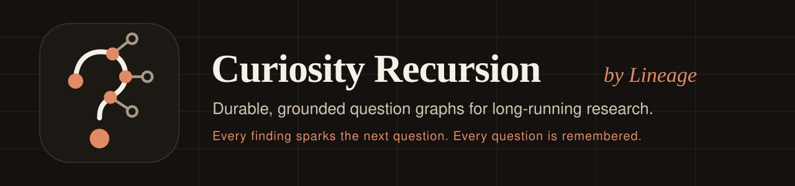
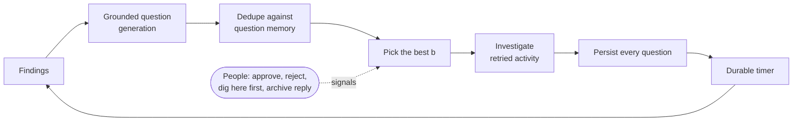
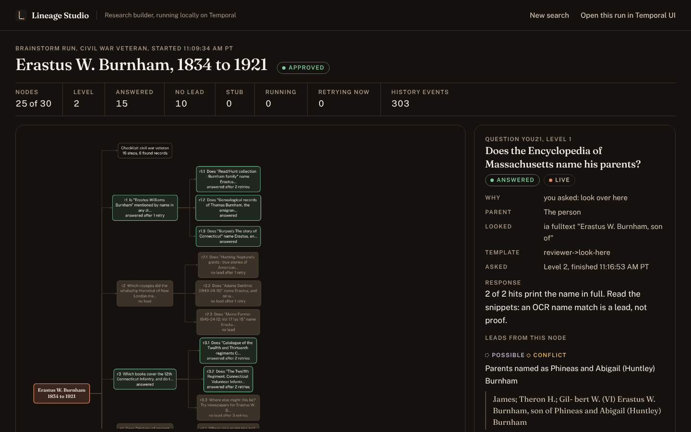

<p align="center">
  
</p>

<p align="center">
  <a href="LICENSE"></a>
  
  
  
  
</p>

---

## Why this exists

Research agents stop early. Ask one to trace a relative through old records and it returns a tidy, incomplete answer, and you end up typing the same things over and over: *go deeper*, *are you sure that is the same man?*, *did you check the church registers?*, *did that archive ever reply?* The supervising becomes the real work, and none of it is written down. Come back a month later with a new name and there is no way to know whether it will get the same care.

Genealogy makes this worse, because the records are **dark data**. They exist, but the systems that should find them cannot see them: a soldier named on page 14 of a scanned regimental history with no index, a marriage register a town clerk answers by mail in three weeks, a box of letters in a cousin's closet. Finding them takes the right next question, then patience.

Two things changed that make a better answer possible. Language models can now read a finding and propose a specific next question. Durable execution engines like [Temporal](https://temporal.io) can keep a long, flaky, human-in-the-loop process alive for days or weeks without losing its place.

**curiosity-recursion** puts the two together. It writes the supervisor's loop down as code.

## What it does

You put in the name of someone who has died. Then:

1. **A circuit runs first.** A baseline checklist for their heritage group (Civil War veteran, the crossing, vital records). "Did you check the synagogues?" becomes a line item that is checked or not.
2. **Every finding sparks new questions.** *He served in the 12th Connecticut* becomes *which books cover that regiment?*, then *does this book name him, and on which page?*, then *are you sure it is the same Erastus?* This is **Curiosity Recursion**.
3. **Every question must quote its evidence.** A question that cannot name the finding that sparked it is rejected. The graph stays auditable.
4. **Nothing is asked twice.** Every question is stored, so the next run rechecks what earlier runs asked and skips repeats.
5. **It survives anything.** Lookups are retried activities, levels are separated by durable timers, and killing the worker loses nothing.
6. **A person stays in charge.** Letters to archives are drafted and held for approval; nothing is ever sent. The report is written only from documented records, with name matches shown as leads and contradictions named, never resolved.

<p align="center">
  
  <br><sub>A real run: the person on the left, every question it asked to the right, each node labelled with what happened.</sub>
</p>

## How it works



The loop is one Temporal workflow. Workflow code decides; every side effect (a full-text search, a search inside a book, writing to the question store) is an activity that Temporal records, retries and never repeats once it has finished.

| | |
|:--|:--|
|  |  |
| **Every node explains itself:** the question, the finding that sparked it, where it looked, what came back, every retry, and any lead it produced. | **Kill the worker mid-run.** Temporal holds the run; restart the worker and it carries on from the same question. |
|  |  |
| **The report** uses only documented records, footnotes every sentence, and names conflicts. Here it caught that a "parents" line describes a man born in 1810, not this one. | **The event history is the audit trail.** Every question, retry, timer and human decision, replayable. |

## Quickstart

Runs on a laptop. No API key needed.

```bash
temporal server start-dev --ui-port 8233          # Temporal CLI; leave it running
python -m venv .venv && .venv/bin/pip install -r requirements.txt
export CR_CONTACT="you@example.org"               # a contact address for polite HTTP access
.venv/bin/python worker.py &                      # task queue: curiosity-recursion
.venv/bin/uvicorn web.app:app --port 8090 &       # live graph UI
.venv/bin/python start_run.py examples/erastus.json
```

Open **http://localhost:8090** for the live graph and **http://localhost:8233** for the Temporal UI. Then try `kill -9` on the worker and start it again.

```bash
.venv/bin/python -m pytest -q tests               # 35 tests, including replay and no-send
```

## The run request

Every switch is a field of `ResearchRequest`, so every idea in the paper can be turned off and measured:

| Field | What it controls |
|:--|:--|
| `depth`, `breadth`, `max_nodes` | How far down one lead, how many questions per finding, how big the graph gets |
| `max_tool_calls` | The budget *B*: checklist steps plus investigations |
| `max_run_minutes`, `level_pause_seconds` | Wall-clock limit and the durable timer between levels |
| `generator` | `rules` (default, no model), `llm` (grounded, key from env) or `hybrid` |
| `use_memory`, `use_circuits`, `verify_nodes`, `dedupe` | The ablations |
| `use_fixtures` | Demo facts from a curated fixture; always off in the benchmark |
| `llm_token_budget` | A hard stop for the model generator |

## Layout

```
cr/
  models.py          every typed value that crosses Temporal (Pydantic), plus grounded()
  gate.py            living-person gate (unknown dates mean living)
  workflow.py        CuriosityRecursionWorkflow + ChecklistPassWorkflow
  activities.py      checklist steps, investigate, brainstorm, compose
  generators/        rules.py (default, no model), llm.py (grounded, key from env), dispatch
  novelty.py         canonical keys, near-duplicate test, novelty score
  memory.py          SQLite question memory (CR_DB)
  evidence.py        leads, conflicts, claim tiers, the sentence validator
  outreach.py        drafts only; approval writes a file; no mail transport exists
  writer.py          the report, from documented claims only
  circuits/*.yaml    circuits and steps (live or stub, with the reason)
  sources/           live.py (public keyless clients), mock_archive.py (bench only)
web/                 live graph UI (Cytoscape.js)
bench/               PREREGISTRATION.md, DATASHEET.md, schema/, data/, convert_kin.py,
                     harness.py, faults.py, baselines/
eval/                score.py, stats.py, plots.py, pilot_stats.py, adjudicate/
tests/               gate, grounding and dedupe, evidence, replay, time skipping, no send, scoring
```

## DarkKin-Bench

A benchmark of hidden records about deceased people, stratified by how dark each record is:

| Tier | Meaning | Scored as |
|:--|:--|:--|
| **T0** | Online and indexed (a catalogue record, a Wikidata statement) | Found |
| **T1** | Online as OCR text or page images only (scanned books, newspapers) | Found, with the page |
| **T2** | Behind a login, paywall or captcha | The right holding named and a correct request drafted |
| **T3** | Offline only (an archive, a church, a town clerk, a family box) | The right holder, record and identifiers in a drafted request |

Version 0 has 39 subjects and 671 hidden records. The hypotheses, budgets and tests are fixed in [`bench/PREREGISTRATION.md`](bench/PREREGISTRATION.md) before any run; a sealed holdout is scored once, at the end.

```bash
.venv/bin/python bench/convert_kin.py --relatives PATH/relatives.json --heritage PATH/heritage-real.json
.venv/bin/python bench/harness.py --agents B3,B5 --budgets 50,100 --split dev --out results/h1.jsonl
.venv/bin/python bench/faults.py --agent B5 --fault-p 0.3 --kill-every 45 --subjects kinher-jewish-01 --out results/h2.jsonl
.venv/bin/python eval/score.py results/h1.jsonl
```

`scripts/run_all.sh` runs everything in order. Automatic matches are candidates until two raters adjudicate them ([`eval/adjudicate/GUIDE.md`](eval/adjudicate/GUIDE.md)).

## Sources

| Source | Mode | Notes |
|:--|:--|:--|
| Internet Archive: catalogue, full-text, search inside one book | live, keyless | lending books refuse inside-book search (HTTP 403), recorded as "source refused" |
| Chronicling America via loc.gov | live, keyless | about 30 s a query |
| Wikidata | live, keyless | some cloud addresses get HTTP 429 on every call |
| Optional public source catalogue (`CR_CATALOG_URL`) | live, keyless | off by default; read-only |
| Vital records, census before 1950, parents, children, work, passenger lists, naturalisation, state roster | stub | demo mode reads `fixtures/burnham-erastus.json`; benchmark mode reads nothing |
| Find a Grave | stub | links only; terms prohibit automated access |
| Pension index, National Archives catalogue, local archive collections | stub | produce outreach drafts for a person to approve |
| Simulated archives (`cr/sources/mock_archive.py`) | bench only | answer drafts by signal after 3 to 21 simulated days |

## Rules this code keeps

- **Deceased people only.** The gate runs in workflow code before any lookup: a death on record, or a birth at least 110 years ago. Unknown means living.
- **Leads are not facts.** A name in OCR text is a lead, shown with its quote. A surname alone never links two people. Conflicts are named, never resolved.
- **Ask first.** Outreach is drafted and held; approval writes a text file. No code path sends mail ([`tests/test_no_send.py`](tests/test_no_send.py)).
- **Polite access.** No scraping where prohibited, no captcha or paywall bypass, rate limits, a contact address in the user agent.
- **Keys stay in the worker's environment** and are optional.

## Known gaps

- The rule-based generator is the only one measured so far. The grounded model generator is built and unmeasured.
- Demo facts come from a fixture, labelled STUB; live sources add leads.
- No continue-as-new yet: a 25-node run reached 303 events and 1.74 MB of history.
- Activities have no heartbeat timeout, so a killed worker's in-flight lookup waits for its 90 s start-to-close timeout before it is retried.
- Wikidata rate limits from shared cloud addresses can fail the identity step in some runs and not others, which confounds agent comparisons. Run the benchmark from an address Wikidata does not throttle, or cache responses, and log the 429 count per run.
- A smoke run on 26 Nov 2026 (`results/smoke-2026-11-26.jsonl`, 3 dev subjects, B3 and B5 at B = 40) checked that the harness, scorer and logs work end to end. It is not a result: no adjudication, n = 3, and the Wikidata throttling above hit the B5 runs and not the B3 runs.

## Citing

See [`CITATION.cff`](CITATION.cff), or use the **Cite this repository** button on GitHub. The paper is *Curiosity Recursion: Durable, Grounded Question Graphs for Genealogical Dark Data*.

## License

Apache-2.0. See [`LICENSE`](LICENSE) and [`NOTICE`](NOTICE).

<p align="center"></p>
