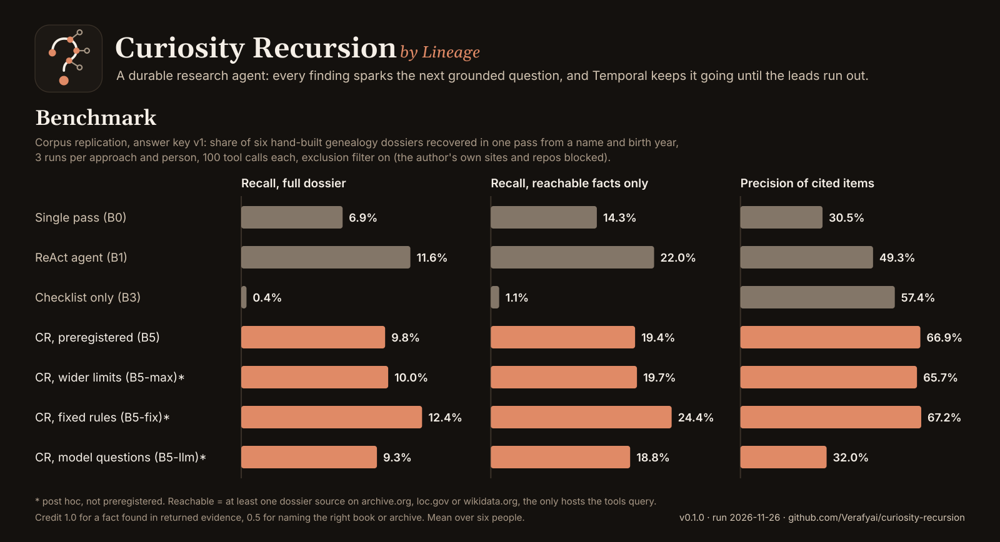
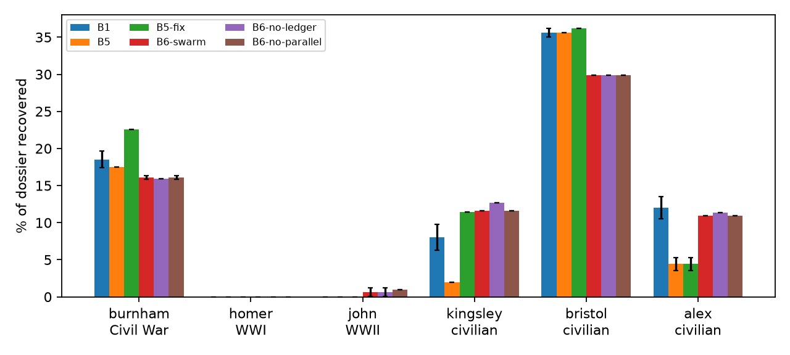

# Curiosity Recursion benchmark

Version v0.1.0. [Click to read the research paper](https://verafyai.github.io/curiosity-recursion/paper/main.pdf) ([PDF in the repo](../paper/main.pdf)). Web page: https://verafyai.github.io/curiosity-recursion/benchmark/

## What the benchmark measures

- Six people from the author's own family research, each with a hand-built dossier: a Civil War soldier (Erastus W. Burnham), a World War I veteran (Homer D. St. John), a World War II veteran (John St. John) and three civilians (Kingsley A. Perry, Edgar H. Bristol, Alex St. John). Everyone is deceased.
- Each dossier was split into atomic facts (birth, service, work, family, places, sources) and frozen as a hash-locked answer key. Every fact is tagged with how its source can be reached: open web, gated site, book, or outreach to an archive or family.
- Each strategy gets only the person's name and birth year, the same public tools (Internet Archive, Chronicling America, Wikidata) and the same budget (100 tool calls), and runs 3 times per person.
- Score: 1.0 for each dossier fact found in the evidence the tools returned, 0.5 for reaching the right record or naming the right book or archive, 0 otherwise. 100% means the whole dossier was recovered in one pass.
- Exclusion filter: the author's own websites, repositories, deployments and accounts, and archive snapshots of them, are blocked at the tool layer, and any returned page that copies dossier prose is dropped, so no strategy can copy the finished research back.
- Reachability ceiling: many dossier facts come from books, gated archives and family outreach that these tools cannot reach. The table also scores each strategy on the reachable facts only (a source on archive.org, loc.gov or wikidata.org).

Answer key **v1** (frozen 2026-11-26), result set `v0.2-live-v0.2`, code commit `3569177`, 3 runs per strategy per person, budget 100 tool calls. Mean ± sd over runs, in percent. Spec: [eval/EVAL-SPEC.md](../eval/EVAL-SPEC.md).

## Leaderboard

| Rank | Strategy | Erastus Burnham (Civil War) | Homer St. John (WWI) | John St. John (WWII) | Kingsley Perry (civilian) | Edgar H. Bristol (civilian) | Alex St. John (civilian) | Overall | Reachable only | Precision | Penalised | Spend | Status |
|---|---|---|---|---|---|---|---|---|---|---|---|---|---|
| 1 | B5-fix: CR rules2 (post hoc fix) | 22.6 ± 0.0 | 0.0 ± 0.0 | 0.0 ± 0.0 | 11.4 ± 0.0 | 36.2 ± 0.0 | 4.4 ± 0.9 | 12.4% | 24.6% | 67.3% | 11.7% | $0.00 | post hoc |
| 2 | B1: ReAct LLM agent | 18.5 ± 1.1 | 0.0 ± 0.0 | 0.0 ± 0.0 | 8.0 ± 1.7 | 35.6 ± 0.6 | 12.0 ± 1.5 | 12.4% | 24.1% | 55.8% | 11.9% | $0.47 | preregistered (v0.1) |
| 3 | B6-no-ledger: swarm without ledger rules (ablation) | 15.9 ± 0.0 | 0.0 ± 0.0 | 0.7 ± 0.6 | 12.7 ± 0.0 | 29.9 ± 0.0 | 11.4 ± 0.0 | 11.8% | 23.1% | 80.2% | 11.8% | $0.00 | preregistered ablation (v0.2) |
| 4 | B6-no-parallel: swarm with one worker (ablation) | 16.1 ± 0.3 | 0.0 ± 0.0 | 1.0 ± 0.0 | 11.6 ± 0.0 | 29.9 ± 0.0 | 10.9 ± 0.0 | 11.6% | 22.7% | 76.0% | 11.6% | $0.00 | preregistered ablation (v0.2) |
| 5 | B6-swarm: CR v0.2 swarm (preregistered) | 16.1 ± 0.3 | 0.0 ± 0.0 | 0.7 ± 0.6 | 11.6 ± 0.0 | 29.9 ± 0.0 | 10.9 ± 0.0 | 11.5% | 22.7% | 76.3% | 11.5% | $0.00 | preregistered (v0.2) |
| 6 | B5: CR (preregistered) | 17.5 ± 0.0 | 0.0 ± 0.0 | 0.0 ± 0.0 | 1.9 ± 0.0 | 35.6 ± 0.0 | 4.4 ± 0.9 | 9.9% | 19.7% | 66.8% | 9.5% | $0.00 | preregistered (v0.1) |

## Reachability ceiling

Recall on the facts the tools could reach at all. Homer has none, so his column is not measured.

| Strategy | Erastus Burnham (111 reachable) | Homer St. John (0 reachable) | John St. John (2 reachable) | Kingsley Perry (144 reachable) | Edgar H. Bristol (61 reachable) | Alex St. John (89 reachable) | Mean (reachable) |
|---|---|---|---|---|---|---|---|
| B5-fix | 41.4 ± 0.0 | n.m. | 0.0 ± 0.0 | 18.4 ± 0.0 | 51.6 ± 0.0 | 11.6 ± 2.3 | 24.6% |
| B1 | 33.8 ± 0.9 | n.m. | 0.0 ± 0.0 | 12.7 ± 2.8 | 50.8 ± 0.8 | 23.2 ± 2.0 | 24.1% |
| B6-no-ledger | 27.9 ± 0.0 | n.m. | 0.0 ± 0.0 | 19.8 ± 0.0 | 42.6 ± 0.0 | 25.3 ± 0.0 | 23.1% |
| B6-no-parallel | 27.9 ± 0.0 | n.m. | 0.0 ± 0.0 | 18.8 ± 0.0 | 42.6 ± 0.0 | 24.2 ± 0.0 | 22.7% |
| B6-swarm | 27.9 ± 0.0 | n.m. | 0.0 ± 0.0 | 18.8 ± 0.0 | 42.6 ± 0.0 | 24.2 ± 0.0 | 22.7% |
| B5 | 32.9 ± 0.0 | n.m. | 0.0 ± 0.0 | 3.1 ± 0.0 | 50.8 ± 0.0 | 11.6 ± 2.3 | 19.7% |

## By era

| Strategy | Civil War | WWI | WWII | civilian |
|---|---|---|---|---|
| B5-fix | 22.6% | 0.0% | 0.0% | 17.4% |
| B1 | 18.5% | 0.0% | 0.0% | 18.6% |
| B6-no-ledger | 15.9% | 0.0% | 0.7% | 18.0% |
| B6-no-parallel | 16.1% | 0.0% | 1.0% | 17.5% |
| B6-swarm | 16.1% | 0.0% | 0.7% | 17.5% |
| B5 | 17.5% | 0.0% | 0.0% | 14.0% |

## By access tier

| Strategy | web_open | book | web_gated | outreach |
|---|---|---|---|---|
| B5-fix | 9.4% | 23.6% | 1.0% | 1.5% |
| B1 | 8.6% | 22.9% | 1.0% | 4.5% |
| B6-no-ledger | 9.1% | 20.4% | 1.0% | 3.8% |
| B6-no-parallel | 8.6% | 20.5% | 1.0% | 3.4% |
| B6-swarm | 8.3% | 20.5% | 1.0% | 3.4% |
| B5 | 5.6% | 20.5% | 1.0% | 0.8% |

## Other measures

| Strategy | Full-credit recall | Holdout recall | Source recall | Precision | Novel candidates / run | False links | Tool calls / run |
|---|---|---|---|---|---|---|---|
| B5-fix | 5.0% | 11.7% | 10.2% | 67.3% | 17.1 | 6 | 52.2 |
| B1 | 5.7% | 12.3% | 8.0% | 55.8% | 5.6 | 2 | 22.2 |
| B6-no-ledger | 6.5% | 12.9% | 10.7% | 80.2% | 28.5 | 0 | 94.4 |
| B6-no-parallel | 6.4% | 12.9% | 10.4% | 76.0% | 33.5 | 0 | 94.4 |
| B6-swarm | 6.4% | 12.8% | 10.3% | 76.3% | 34.0 | 0 | 94.4 |
| B5 | 4.2% | 9.8% | 3.7% | 66.8% | 3.6 | 3 | 22.7 |

## Is any difference real?

Paired over the six people. With six people the smallest possible p is 0.031, so read these as direction, not proof.

| Comparison | People | Mean difference (points) | Better / worse | p (exact sign-flip) | Holm p |
|---|---|---|---|---|---|
| B5 vs B1 | 6 | -2.5 | 0 / 3 | 0.250 | 1.000 |
| B5-fix vs B1 | 6 | +0.1 | 3 / 1 | 1.000 | 1.000 |
| B6-swarm vs B1 | 6 | -0.8 | 2 / 3 | 0.625 | 1.000 |
| B6-swarm vs B5-fix | 6 | -0.9 | 3 / 2 | 1.000 | 1.000 |
| B6-swarm vs B5 | 6 | +1.6 | 3 / 2 | 0.500 | 1.000 |
| B6-swarm vs B6-no-ledger | 6 | -0.2 | 1 / 2 | 0.500 | 1.000 |
| B6-swarm vs B6-no-parallel | 6 | -0.1 | 0 / 1 | 1.000 | 1.000 |

## Leakage audit

Every strategy ran with the exclusion filter on: the dossier author's own sites, repositories, deployments and accounts are blocked at the tool layer, and any returned page that copies dossier prose is dropped. Counts per strategy:

| Strategy | Runs | Blocked by host rule | Dropped by dossier-overlap guard | Runs without a tool log |
|---|---|---|---|---|
| B5-fix | 18 | 0 | 6 | 0 |
| B1 | 18 | 0 | 5 | 0 |
| B6-no-ledger | 18 | 0 | 0 | 0 |
| B6-no-parallel | 18 | 0 | 0 | 0 |
| B6-swarm | 18 | 0 | 0 | 0 |
| B5 | 18 | 0 | 0 | 0 |

## Scorer audit

Scorer audit: not run for this result set.

## Answer key hashes

- `burnham`: `2750397ec0d728b0faa9319f2afd4a43993156ad19cdf6ac161902b7ba8452e0`
- `homer`: `97246745c0a641986a5a3256f511b7e945bf459bcb2dd46259393fd993d8af8d`
- `john`: `e1fadcf36c92e7480f6c5440b8e6ea233b283636616e595e23a15d2e905ad9df`
- `kingsley`: `7176dc8c25ac6cd9f89a5626c8ce76570c469bd084d74919dad1c7600bc0ec1f`
- `bristol`: `53f9fde3972539560be3f4b18124c14fad94455db3785a9431ef24bb1fb03f79`
- `alex`: `95fd263256f3600ab33b91331bc6303765c755d5b2ed8fcab864ecbd794dbba8`

## History

| Answer key | Result set | Best strategy | Best overall |
|---|---|---|---|
| v1 | v0.2-live-v0.2 | B5-fix | 12.4% |
| v1 | 20261126T1600 | B5-fix | 12.4% |
