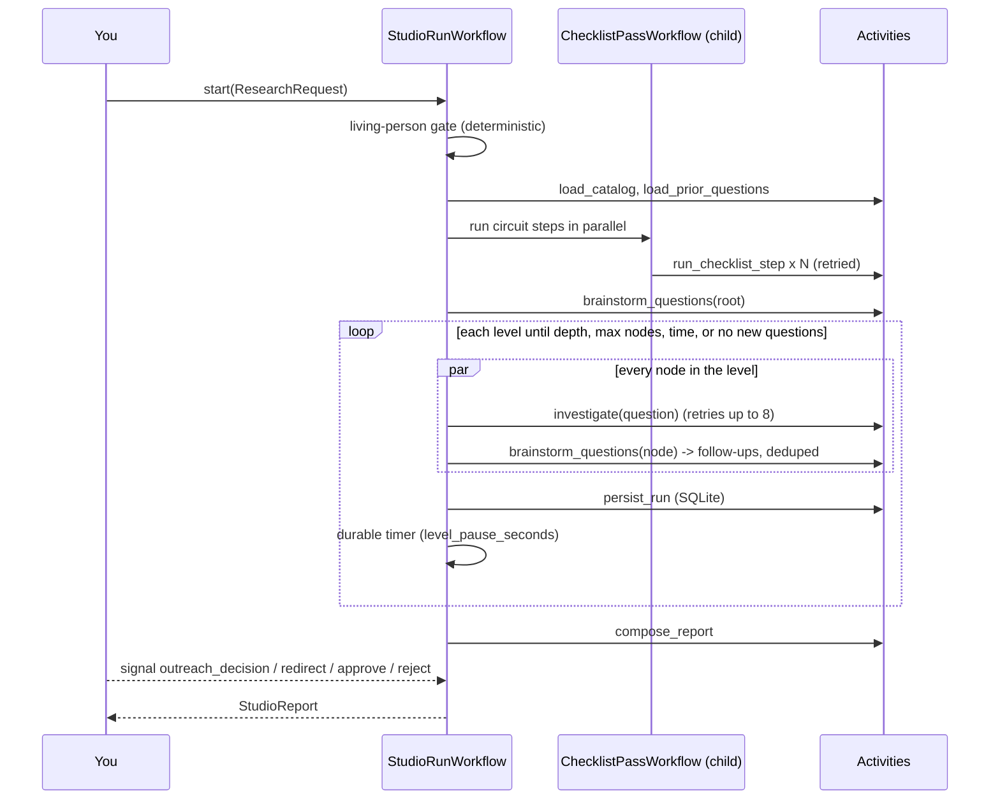

# Lineage Studio Builder (local, on Temporal)

A local version of Lineage Studio that runs on the open-source Temporal dev server.
You put in one name, pick **Brainstorm**, and hit **Search**. The run works through the
circuit's baseline checklist, then keeps asking new questions from what it found
("he served in the 12th Connecticut, which books cover that regiment, does any of them
name him, on which page?"). It shows the brainstorm as a live node graph, keeps going
for as long as you allow, survives the worker being killed, and waits for your approval
before anything is published. Nothing is ever sent, bought or written to Lineage production.

## Run it

Needs Python 3.11+, the Temporal CLI, and Chrome only for screenshots.

```bash
# 1. Temporal dev server
temporal server start-dev --ui-port 8233 --db-filename ./data/temporal-dev.db

# 2. Python env
cd studio
python3 -m venv .venv && .venv/bin/pip install temporalio==1.37.0 pydantic fastapi "uvicorn[standard]" httpx

# 3. Worker and web app (both left running in the background)
nohup .venv/bin/python worker.py > logs/worker.log 2>&1 & echo $! > data/worker.pid
nohup .venv/bin/uvicorn web.app:app --host 127.0.0.1 --port 8090 > logs/web.log 2>&1 & echo $! > data/web.pid

# 4. Open
#   Studio Builder:  http://localhost:8090      (start screen, recent runs)
#   One run:         http://localhost:8090/run/<workflow id>
#   Temporal UI:     http://localhost:8233      (operator view: history, retries, timers, signals)

# Command-line start, same typed input as the form
.venv/bin/python start_run.py examples/erastus.json
```

Task queue: `lineage-studio-builder` (the older playground worker owns `lineage-studio`).

### Kill-the-worker demo

```bash
kill -9 $(cat data/worker.pid)          # the run page turns red: "Worker is down. Temporal is holding this run"
nohup .venv/bin/python worker.py > logs/worker.log 2>&1 & echo $! > data/worker.pid   # it carries on from the same node
```

## What you see

- **Start screen**: one name field, optional born, died, place and other spellings, a question,
  mode (Brainstorm or Checklist only), circuit, depth, breadth, max total nodes, max run time,
  pause between levels, outreach mode, and "simulate flaky archives".
- **Brainstorm graph** (Cytoscape.js, left to right): the person, the checklist node, then every
  question. Node colours are read from the Lineage tokens in `web/static/studio.css`: frontier
  outline queued, terracotta running, amber **retrying 3/8** (read live from Temporal's pending
  activities), green answered with data, muted fill no lead, dashed lore outline STUB, red failed.
  Every state is also written on the node, so colour never carries the meaning alone.
  Click any node for the question, the finding that sparked it, its parent, the level, where it
  looked, the response, the snippets and links, and every retry.
- **Panels**: open questions, answered questions with responses, outgoing research requests,
  failures and retries, checklist coverage, run log (Pacific time).
- **Report** ("Make something from this", the kin Studio panel): the three Studio cards with
  their thresholds (chapter 8 facts, newsletter 2, documentary coming soon), the draft written
  only from documented claims with every sentence footnoted and a tier chip on every source,
  the proof line ("10 claims used, 10 footnoted, 0 uncited sentences."), a **Possible** column of
  leads with their verbatim quotes, and a **Conflicts** column. Approve, Reject, or "Dig here
  first" (your own question, sent as a signal, runs before you decide).

## Look and feel

The app uses the Lineage brand scope from kin (`app/globals.css` `.lineage`, `components/lineage-frame.tsx`):
dark only, warm ink on one ground (#14110e), terracotta accent, Fraunces for display and Public Sans
for everything else (self-hosted in `web/static/fonts/`, SIL Open Font License), a sticky 64px header
with the Lineage logo, and pill buttons. All colour literals live in `web/static/studio.css`. Evidence
tier chips follow the kin design spec: filled dot for DOCUMENTED and TOLD, hollow dashed dot for LORE
and POSSIBLE. No progress bars, no completion percentages, no celebration.

## Evidence model (leads, facts, conflicts)

`studio/evidence.py` runs inside `compose_report`:

- Every OCR or search-snippet match becomes a **lead** (`Lead`, tier `possible`) with its verbatim
  quote, source id (`ia:<identifier>` for books), confidence, and how it was matched, in words. Leads
  never enter the draft. A lead never decides a date.
- A "son of A and B" parents lead needs the subject's full name in the text and his own given name
  just before the phrase, so a sibling's line is not used (no shared-surname links).
- A match inside a comma separated roster (for example the 12th Connecticut roster, which lists
  "Burke, John Burnham, Erastus W. Carlan, John") is kept as a normal lead with a note to check the
  list's name order on the page. An earlier version wrongly marked it weak.
- **Conflicts** (`Conflict`) are named and never resolved: two different parent pairs, or a lead
  date that disagrees with a documented one. Leads from the same passage are pulled into the
  conflict. In the Erastus runs this caught that the Encyclopedia of Massachusetts passage naming
  "Erastus W. Burnham, son of Phineas and Abigail (Huntley)" describes a man born 1810 and died
  1854, so those parents are probably not this Erastus's.
- `studio/writer.py` `check_sentence()` is a port of kin `validate.ts` `checkSentence`: a sentence
  drops if it cites no claim, cites a lead or an `inferred` claim, states an interior state, makes a
  causal link no record makes, tells a family story outside "Your family remembers that", or uses a
  number no cited record holds.

## Tests

```bash
.venv/bin/python tests/test_evidence.py   # evidence model and validator, no server needed
.venv/bin/python tests/test_replay.py     # replays every run in the local Temporal against current code
```

## Outreach

Only **Ask me before sending** works. Stub questions that need a human (pension file at NARA,
Connecticut State Library, a town clerk, a museum collection) produce a drafted letter shown
as "awaiting your approval". Approving writes it to `data/outbox-not-sent/` for you to send
yourself. **Automate outreach** is shown disabled ("not enabled in the local demo"); if a client
sends it anyway, the server rewrites it to ask first. There is no SMTP, no Gmail and no API key
in this app. Letters never invent an address; they point at where the real one is listed.

## Architecture

```mermaid
flowchart LR
  subgraph Browser
    UI[Studio Builder page<br/>form, live graph, panels, report]
  end
  subgraph Local box
    API[FastAPI :8090<br/>web/app.py]
    W[Worker<br/>worker.py<br/>task queue lineage-studio-builder]
    DB[(data/studio.db<br/>SQLite: runs, questions, outreach)]
    OUT[data/outbox-not-sent/<br/>approved letters as text]
  end
  subgraph Temporal dev server
    T[(Temporal :7233<br/>event history in dev.db)]
    TUI[Temporal UI :8233]
  end
  subgraph Public, keyless
    L[api.lineage.rexstjohn.com<br/>GET /v1/sources, /v1/taxonomy]
    WD[Wikidata]
    IA[Internet Archive<br/>metadata, full-text, inside-book]
    CA[Chronicling America<br/>loc.gov]
  end
  UI -- poll 1.5s --> API
  API -- start, query progress, describe pending activities, signals --> T
  T <-- workflow and activity tasks --> W
  W --> L & WD & IA & CA
  W --> DB & OUT
  TUI --- T
```



## Typed schema (studio/models.py)

All values crossing Temporal are Pydantic models, sent with
`temporalio.contrib.pydantic.pydantic_data_converter`, so the Temporal UI shows real field names.

- `ResearchRequest`: `person` (`full_name`, `name_variants`, `birth_year` and precision,
  `birth_place`, `death_year`, `death_place`, `family_notes`), `question`, `circuit_id`,
  `mode`, `depth`, `breadth`, `max_nodes`, `max_run_minutes`, `level_pause_seconds`,
  `outreach`, `simulate_flaky_archives`, `require_approval`, `approval_timeout_hours`.
- `Finding` (one per checklist step or question): `step_id`, `stage` (kin's 7 stages),
  `source_slug`, `mode` live or stub, `status`, `confidence`, `claims[]`, `citations[]`
  (url, title, item id, snippet, name match), `notes`, `attempt`.
- `Question` (a graph node): `id`, `parent_id`, `depth`, `round`, `text`, `because` (the finding
  that sparked it, quoted), `template`, `plan` (handler and query), `status`
  (pending, running, answered, no_lead, stub, error, skipped), `answer`, `citations`,
  `snippets`, `attempts`, `failures`, `seeded_from`, `outreach_id`.
- `OutreachDraft`: `to`, `channel`, `contact_hint`, `subject`, `body`, `status`.
- `Progress` (query `progress`): status, stage, checklist findings, questions, outreach,
  levels, log, report.
- `StudioReport`: sections of `Sentence {text, claim_ids}`, facts, told, cards
  (chapter 8 facts, newsletter 2, documentary soon), checklist coverage, questions, leads,
  open questions, outreach, decision, markdown.
- Signals: `approve(Decision)`, `reject(Decision)`, `redirect(Redirect)`, `note(str)`,
  `outreach_decision(OutreachDecision)`.

## Durability

- Every lookup is an activity with a retry policy (2s initial, x2 backoff, 8 attempts).
  "Simulate flaky archives" fails about 3 in 10 investigations on their first one or two
  attempts so the orange "retrying n/8" state is visible; real timeouts and 5xx retry the same
  way. A 4xx (for example a lending-library book whose full text is not public) is recorded as
  "source refused" and not retried.
- Killing the worker loses nothing: finished lookups are in event history and are not repeated.
  The page shows "Worker is down" with the saved event count and pending lookups, and carries
  on when a worker comes back. See `captures/durability.log`.
- The checklist runs as a child workflow, so its history is separate. A 40-node brainstorm is
  a few hundred events and well under 1 MB of history. For runs of hundreds of nodes or weeks
  of timers, add `workflow.continue_as_new` with the question list as state, or run each
  first-level question's subtree as its own child workflow.
- Every level writes all questions to `data/studio.db`. A later run for the same person
  (`given-surname-birthyear`) re-asks the earlier run's first-level questions as `r1, r2, ...`
  ("asked by earlier run X; rechecking") and dedupes new ideas against everything asked before.

## Live vs stub

Live, keyless, no credits:
- Lineage public catalog `GET /v1/sources` and `/v1/taxonomy` (never `POST /v1/searches` or `/v1/runs`)
- Wikidata `wbsearchentities` and `wbgetentities` (identity, parents and spouse of a matched item)
- Internet Archive: metadata search, **full-text search across books**, and **search inside one book** with page numbers
- Chronicling America via loc.gov JSON (name search, obituary year, unit and ship mentions)

Stub, clearly labeled "STUB" with the reason:
- Vital records (birth, marriage, death), census before 1950, parents, children, work records,
  passenger manifests, naturalisation, the Record of Service roster: claims come from the Lineage
  eval fixtures copied from kin (`fixtures/burnham-erastus.json` ships; the family dossier file
  `fixtures/relatives.json` is optional and not in the public repository). A person without a fixture gets "No fixture claim for this person".
- Find a Grave: memorial link from the fixture only (terms prohibit automated access).
- NPS Soldiers and Sailors: ids from the relatives fixture (no public API).
- Pension index (FamilySearch, user OAuth), NARA catalog (needs a key), local archive collections
  (letter only): stub nodes that draft an outreach letter.

Name matches in OCR text are labeled "strong" (full name form found) or "surname only". Brainstorm
hits are shown as leads with quotes and links. Only documented fixture claims and the family's
own notes ("told") go into the chapter text.

## How this maps to the real Lineage Studio (kin)

| kin (rexsaurus/kin) | here |
| --- | --- |
| `lib/content/studio.ts`: Studio cards (chapter, newsletter, documentary), thresholds 8 and 2, templates book-of-daniel, service-record, the-crossing, oral-history, photo-essay | `CardState` in the report; circuits pick service-record, the-crossing, book-of-daniel |
| `lib/services/studio.ts`: `startStudio` / `runStudio` in `after()`, refund on failure, living gate, publishable check | `StudioRunWorkflow`; the gate is in workflow code; no credits are charged locally |
| `lib/content/validate.ts`: every sentence carries claim ids; interior states and causal links dropped | `studio/writer.py` ports the rules; the writer is deterministic, not a model |
| `lib/gate.ts` `isPresumedLiving`, `MAX_PLAUSIBLE_AGE = 110` | `_gate` in `studio/workflows.py` |
| `lib/search/run-pass.ts` `STAGE_LABELS` (identity, vital, place, kin graph, military, local holdings, assembly) | `Finding.stage` and `studio/circuits.py` |
| `lib/inngest/functions.ts` (`search-pass-run`, retries 2) | Temporal workflows and activities with explicit retry policies |
| `lib/search/examples.ts` (Erastus Burnham, Mary Devine) and `evals/golden/*.json` | `examples/*.json`, `fixtures/` |

## Porting to production

- Keep the web app where it is (Vercel is fine for the page and API routes). Workers are
  long-lived pollers, so they **cannot run on Vercel**: run them on Fly.io, Railway, Render or a
  small VM, two or more for failover.
- Temporal itself: self-host (Postgres-backed `temporal` server via Docker or Helm) or Temporal Cloud.
  At Lineage's volume one small cluster serves every run.
- Swap the SQLite question store for a Neon table keyed by person and question key, written by
  the same `persist_run` activity, so every future run rechecks what earlier runs asked.
- Replace stubs one by one with real `lib/sources/*` clients behind the same activity
  signature; keyed sources read secrets in the worker only.
- Outreach stays "ask first": an approved draft becomes a Lineage letter request, never an
  automatic send.
- Brainstorm is rule-based today (`studio/brainstorm.py`, lead templates keyed on unit, ship,
  place, marriage, school, congregation, death year, book hits, "son of" snippets, collections and
  checklist gaps, plus "are you sure?" and "where else?" on every node). It runs inside an
  activity, so a model can replace it later without touching workflow code.

## Files

- `studio/models.py` schemas; `studio/workflows.py` workflows; `studio/activities.py` side effects;
  `studio/brainstorm.py` question generator; `studio/writer.py` report; `studio/circuits.py`
  checklists; `studio/sources.py` live clients; `studio/fixtures.py` fixture reader
- `worker.py`, `start_run.py`, `web/app.py`, `web/index.html`, `web/run.html`, `web/static/`
- `captures/` screenshots and `durability.log`

## Known gaps

- A "strong" name match means the full name string is in the OCR text, not that it is the same person
  (a search for "Phineas Burnham" also finds a 1950s comic). Every brainstorm answer is a lead for a human to check.
- Most documented facts come from the kin eval fixtures (stubs). The live sources add leads, not facts.
- "son of A and B" leads now need the subject's own given name just before the phrase. Run 104003 was
  brainstormed before that fix and shows a wrong "Amos and Martha (Billings)" parents lead, taken from a
  line about Lois E. Burnham.
- Chronicling America on loc.gov is slow (about 30s a query). Internet Archive lending books refuse
  inside-book search (HTTP 403), which is recorded as "source refused".
- Title search sometimes brings back books that only share a surname or a regiment number.
- No continue-as-new yet, HathiTrust not used, and the brainstorm is rule-based (no model).
- Activities have no heartbeat timeout, so after a worker is killed an in-flight lookup waits for
  its 90 second start-to-close timeout before it is retried.
- From some cloud IPs Wikidata answers HTTP 429 to every call; those steps retry 8 times and then
  show as failed in the checklist. That is the source refusing, not the app.
